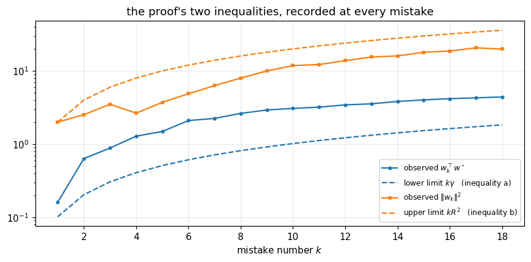
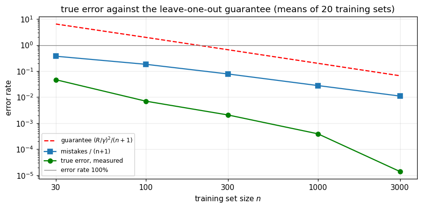
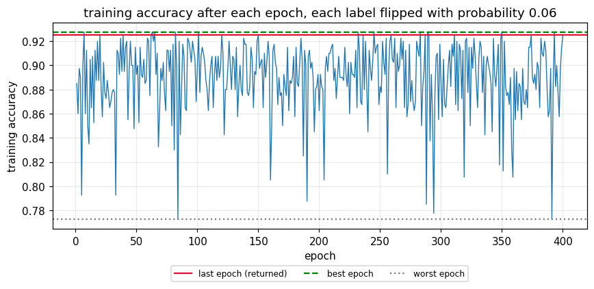

# Does Stopping Mean the Perceptron Has Learned?


[](https://colab.research.google.com/drive/1g66DwR6UeVGxuG4mS8Zsr81XSEF4AslW)

**The perceptron is guaranteed to stop. Does stopping mean it has learned anything?**

Novikoff's theorem guarantees that on linearly separable data the perceptron eventually classifies every *training* point correctly. This project asks whether that guarantee says anything about *new* data. It answers the question with a from-scratch NumPy implementation, experiments on synthetic data with a known ground truth, and a written study of the theory behind them.

> Built for **UTS 32513 / 31005 Advanced Data Analytics Algorithms (Machine Learning)** (Spring 2026), Assignment 2, Option 1: *study and implement a fundamental ML model*.

---

## The short answer

**No, not by itself.** A perceptron trained on pure coin-flip labels still stops with zero training error, but it scores no better than guessing on new points:

| Labels (200 points, 500 dimensions) | Stopped | Training error | True error on 5,000 new points |
|---|---|---|---|
| Coin flip (nothing to learn) | 3 / 3 runs | 0 | **0.492 - 0.497** (guessing) |
| From a real rule with margin 0.10 | 3 / 3 runs | 0 | **0.015 - 0.026** |

Stopping only means the sample was memorised. What actually guarantees learning is a **small number of mistakes per example on i.i.d. data drawn from a distribution that has a margin**. Under those conditions, a leave-one-out argument bounds the expected true error:

$$\mathbb{E}[\text{true error}] \le \frac{(R/\gamma)^2}{n+1}$$

The experiments confirm that the measured true error stays below this bound at every training-set size.

## Key experiments

### 1. Watching the convergence proof happen

The two inequalities in Novikoff's proof, (a) $w_k^\top w^\star \ge k\gamma$ and (b) $\lVert w_k\rVert^2 \le kR^2$, are recorded *inside* the training loop at every mistake. Both held at all 18 mistakes. The run stopped after **18 mistakes, against a worst-case bound of 193**: the bound is valid but loose, because it covers the worst possible ordering of examples.



### 2. From the mistake bound to unseen data

With 20 training sets per size and the true error measured on 200,000 fresh points, the measured error sits well below the leave-one-out guarantee at every n:

| n | Mistakes / (n+1) | Bound $(R/\gamma)^2/(n+1)$ | Measured true error |
|---|---|---|---|
| 30 | 0.374 | 6.452 | 0.0468 |
| 100 | 0.183 | 1.980 | 0.0070 |
| 300 | 0.078 | 0.664 | 0.0021 |
| 1,000 | 0.028 | 0.200 | 0.0004 |
| 3,000 | 0.011 | 0.067 | 0.00001 |



### 3. When the guarantee breaks: label noise

When 6% of labels are flipped, no separating hyperplane exists. The perceptron never converges: it still makes 64-78 mistakes per epoch after 400 epochs. The weights it returns are effectively arbitrary, since training accuracy swings between 0.77 and 0.93 from one epoch to the next.



### 4. Two repairs, chosen properly

Both repairs run inside the same training loop as the textbook rule:

- **Pocket** (Gallant, 1990): keep the weights with the best training accuracy seen so far.
- **Averaged** (Freund & Schapire, 1999): return the average of all weight vectors.

The model is selected on a separate validation set, and the test set is used only once, with a 95% Hoeffding interval. The chosen model (pocket) scored **0.937 ± 0.030 on test**, its true accuracy was **0.940**, and that matches the ceiling of the true rule $w^\star$ itself (0.940).

Repeating the noisy experiment on 20 fresh training samples shows why the repair matters:

| True accuracy over 20 runs | Vanilla | Pocket | Averaged |
|---|---|---|---|
| Mean | 0.859 | 0.930 | **0.938** |
| Std | 0.064 | 0.021 | **0.003** |
| Worst run | 0.749 | 0.847 | **0.928** |

The vanilla perceptron's result depends heavily on luck, while the averaged perceptron is almost perfectly stable.

## What's implemented

All from scratch in NumPy, with no machine-learning library:

- `Perceptron`: the Rosenblatt update rule with the bias as an extra coordinate. A single `fit` returns three answers (last, pocket, averaged weights) and optionally records the proof's quantities at every mistake.
- `make_separable`: draws points uniformly on the unit sphere and keeps only those at least γ from a hidden boundary $w^\star$, so the margin and the true error are known exactly.
- `draw`: noisy samples (each label flipped with probability 0.06) for training, validation, test and true-error measurement.
- `perceptron_loss`, `predict`, `accuracy`, `bound_inputs` (measures R and γ).

## Files

| File | Description |
|---|---|
| [`perceptron_mistake_bound.ipynb`](perceptron_mistake_bound.ipynb) | Implementation and all experiments, with outputs |
| [`docs/Perceptron_Mistake_Bound_Journal.pdf`](docs/Perceptron_Mistake_Bound_Journal.pdf) | 21-page study: problem definition, hypothesis space, loss, the proof, results, repairs and limitations |
| [`assets/`](assets/) | Figures used in this README |

## How to run

Open the notebook in [Google Colab](https://colab.research.google.com/drive/1g66DwR6UeVGxuG4mS8Zsr81XSEF4AslW) and run all cells, or run it locally:

```bash
pip install numpy pandas matplotlib jupyter
jupyter notebook perceptron_mistake_bound.ipynb
```

The notebook generates all of its own data. No downloads or GPU are needed.

## Limitations

- A single hyperplane cannot represent non-linear patterns such as XOR.
- All data is synthetic. That is the only way to know $w^\star$, γ and the true error exactly, but it means nothing here is evidence about a real dataset.
- The distribution has an empty band around the boundary, which makes it easier than most real problems.
- The leave-one-out bound holds on average over training sets, not for any single one.

## Tech stack

Python, NumPy, pandas, Matplotlib
